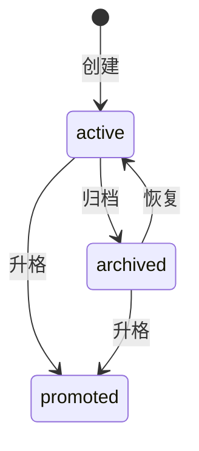
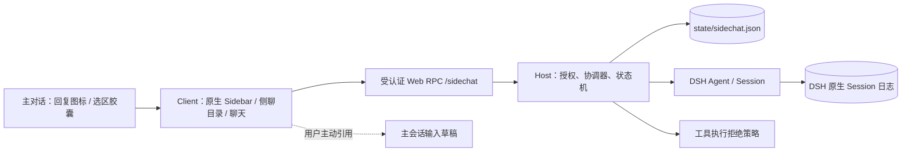

# 产品与架构设计

> **旁敲侧击 / Side Chat** · 面向 DeepSeek Harness 0.2.2-rc.5 · 开发预览版
>
> 本文区分已实现的设计和仍需验收的交互，不把源码存在等同于 Desktop 实测通过。

## 1. 产品定位

用户在主对话中遇到术语、代码片段或想进一步讨论的观点时，应当能**就地展开独立的多轮侧聊**，不改变主会话的消息顺序和上下文。

基本原则：

1. **来源明确**：从 AI 回复或选区发起，记录父 Session、源消息 ID、可选原文和上下文模式。
2. **主线隔离**：侧聊使用自己的 DSH Agent / Session，主会话不自动接收侧聊的输入和输出。
3. **回流由用户决定**：复制或插入主输入草稿；不会自动发送。
4. **生命周期独立**：侧聊可归档、恢复、升格为正式会话；升格不等于回流。
5. **扩展优先**：使用 DSH Cordis、Agent/Session、官方 UI Slot、右侧 Sidebar；不替换主聊天内核。

不以此版本实现通用分支图、任意层级对话、侧聊 Agent 自主修改文件或完整复刻原生多模态聊天组件。

## 2. 交互与视觉

### 发起侧聊

- AI 回复下方使用双气泡图标，悬浮提示「侧聊」。
- 选中文字并松开鼠标后，在 DSH 的「引用文本」胶囊中增加「侧聊」操作；拖动选区时不显示新按钮。
- Light（默认）只提供必要的引用背景；Fork 继承源消息所属**已完成轮次之前**的主线事件。
- 首个问题与侧聊创建形成一条操作路径。

### 浏览与追问

- **唯一目录**位于 DSH **原生右 Sidebar** 的「旁敲侧击」页面中。可搜索、选择、归档和恢复；不再放置第二套悬浮圆点目录。
- 消息正文右侧靠近来源顶部或原始选区位置显示小型侧聊标记。悬停展示两行：「引用内容 / 标题」和「首个问题」；点击直接打开对应侧聊。
- 对话输入区为单个轻量输入框，内容自动增高到 180px；禁用原生 textarea 拖拽角标；右下角小圆形发送按钮，生成期间同位置切换停止操作。
- 侧聊顶部引用块使用浅色、方角样式；用户消息采用低对比度深色填充；AI 回答操作栏靠左，使用图标和 Tooltip。
- 使用 DSH 主题变量，遵循深浅模式及 `prefers-reduced-motion`。

### 回到来源

- **全回复锚点**：滚动到真正的 `assistant-step` 回复正文，并对整条回复闪烁高亮；不能高亮 `turn-tail` 底部工具栏。
- **选区锚点**：在来源文本节点上恢复 DOM Range，仅高亮匹配片段；富文本跨节点可匹配。
- 未加载原文或文本变化导致精确匹配失败时显示错误，不随意高亮其他内容。
- 消息可能有相同内容，未来可在锚点元数据中增补稳定选区偏移或节点路径以消除重复匹配歧义。

## 3. 状态与数据

每条 Side Chat 记录独立的元数据，完整消息历史仍交给 DSH Session 保存：

```ts
type ContextMode = 'light' | 'fork'
type SideChatStatus = 'active' | 'archived' | 'promoted'

interface SideChat {
  id: string
  parentSessionId: string
  childSessionId: string | null
  clientRequestId: string
  anchor: {
    messageId: string
    eventSeq?: number
    selectedText?: string
  }
  title: string
  mode: ContextMode
  status: SideChatStatus
  revision: number
  createdAt: string
  updatedAt: string
}
```

当前使用 Host 独立持久化文件 `state/sidechat.json`（以 `dshHomePath('state', 'sidechat.json')` 定位），子 Session ID 以 `session-sidechat-` 开头。此项目尚未正式发布，因此**不处理早期实验包名或存储文件的兼容**。

状态转移：



- 重复创建通过 `clientRequestId` 实现幂等；更新检查 `revision`。
- 不存储模型密钥或第二份完整 Session 对话历史。
- 同一来源可以建立多个侧聊；来源消息不可见时目录仍应可用。
- 文件 Repository 是**单进程串行 JSON 存储**，不保证多个 DSH Host 进程并发写入安全。

## 4. 体系结构



| 层 | 责任 |
| --- | --- |
| Client | 触发、输入、目录、历史投影、来源定位；不直接操作 Session 存储 |
| RPC | DSH 身份认证及来源检查、owner 授权、消息体大小限制、请求参数校验 |
| Host | SideChat 生命周期、父子 Session 归属、幂等、读写隔离与 Agent 所有权 |
| DSH | Agent 推理、Session 事件日志、归档/恢复、Fork、原生会话可见性 |
| Store | SideChat 元数据，不复制 DSH 消息历史 |

### 安全与上下文

- Client 不能自由指定其他用户的 Session；Host 进行 owner 与父会话来源验证。
- 侧聊 Agent **拒绝全部工具**（包含只读调用），由 Agent `setup` 中的工具守卫强制执行；不以提示词替代权限。
- Light 使用小范围来源背景，不继承主 Session 全文；Fork 基于稳定事件边界创建原生子会话，后续独立推进。
- 侧聊对话的展示从子 Session 日志投影；Fork 继承的父会话前缀在 UI 中过滤，不伪装成侧聊的新消息。
- 侧聊升格时解除隐藏并继续使用原本子 Session，不把历史复制给父 Session。

## 5. 已实现与待验证

源码已包含 Host/Client、轻量与 Fork 上下文、认证 RPC、文本历史、侧聊目录、来源定位、工具拒绝、归档/恢复/升格，以及显式回填。CI 已验证编译、包构建与 Web Profile 认证 RPC。

**尚未完成的验收**：真实 Desktop 选区胶囊和多轮模型交互、跨重启恢复、升格后的会话可见性、各窗口尺寸与主题，以及真实模型调用下的工具守卫。Side Chat 也未实现主 Agent 主动检索其他侧聊的扩展能力。

详细状态见 [路线图](roadmap.md)。
