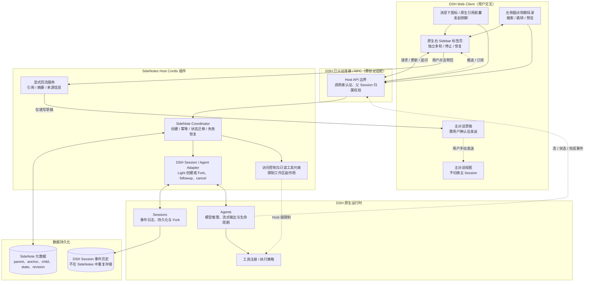
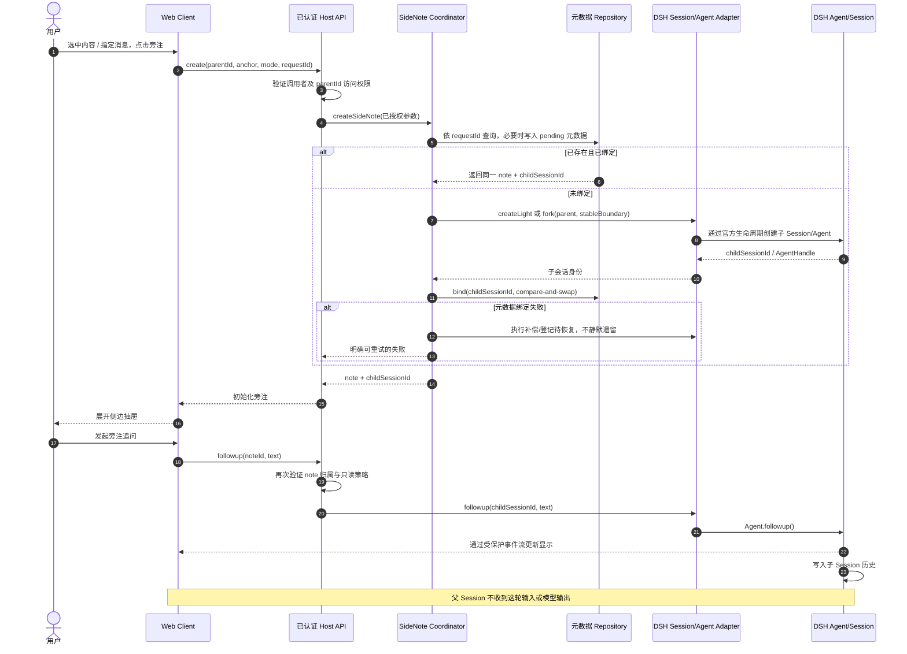
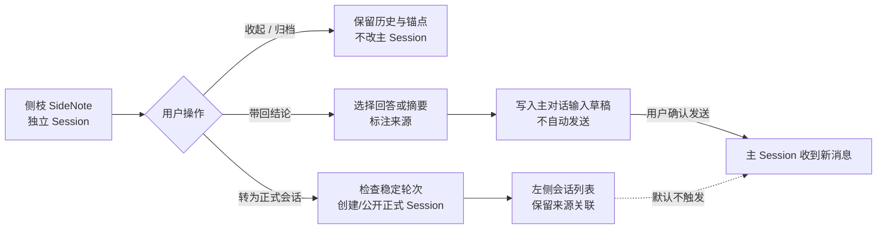
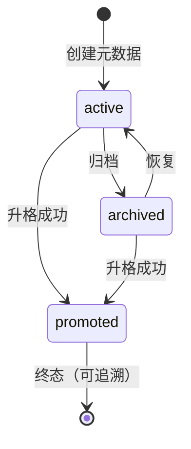

# Side Chat · 旁敲侧击｜产品与技术设计

> 状态：设计基线 v0.1 · 2026-11-20。本文描述目标产品；不能将规划功能视为已实现。

## 1. 问题和目标

DSH 的普通对话严格线性。用户遇到术语、技术细节或临时想法时，希望在原位多轮询问，又不想让解释、探索性讨论占据主会话。独立 Fork 虽有上下文，却需要切换整个会话。Side Chat 以“贴着原文展开的独立侧边对话”解决这个问题。

### 产品原则

- **原位、轻量**：主会话不跳转；侧聊在原生右 Sidebar 打开，左侧圆点目录辅助快速导航。
- **独立、可恢复**：每个旁注拥有独立的会话和持续历史，关闭 UI 不等于销毁。
- **有出处**：旁注记录父会话、源消息、选区、创建时的上下文边界；支持跳回源位置。
- **单向继承、显式回流**：侧枝可以读取创建时授权的主线背景，但不能自动影响主线；回流须经用户操作。
- **升格与回流正交**：转为左侧可见的正式 Session 不意味着将内容同步给父会话。
- **优先扩展，不改内核**：基于官方 Cordis 插件、Session/Agent、UI Slot；不替换主对话实现。

### 非目标

不做通用无限层级图编辑器；不默认在旁注中运行写入性工具；不偷偷同步所有侧枝上下文；第一版不追求一比一复制原生 Chat 的所有能力。

## 2. 交互

1. 已完成消息的操作区显示小图标「侧聊」（Tooltip）；选中文字并结束拖动后，原生「引用文本」胶囊增加「侧聊」按钮；空选区时以整条回复为锚点。
2. 弹出右侧抽屉（窄屏改为覆盖浮层），显示来源引用、独立消息流、输入框和停止按钮；主页面保持当前滚动位置。
3. 原生 Turn Navigator 的左侧增加侧聊圆点轨道：顶部放大镜、下面每条侧聊一个小圆点；鼠标悬停展开检索卡片，展示引用原文与回答。
4. 每条侧聊的原消息右侧出现细小锚点，靠近源选区的垂直位置；点击锚点直接打开对应侧聊。侧聊按锚点与创建时间排序并支持检索。
5. 回复操作以图标+DSH Tooltip 呈现：复制、引用到主对话草稿；页面标题区提供定位、摘要、归档及升格。
6. “带回”默认填入主会话输入框，不自动发送；定位原文时整条消息或选中片段高亮闪烁 3 次；正式 Session 升格后仍保留原始锚点。

**交互边界**：左侧点状目录是导航，不是会话切换；右侧 Sidebar 是独立聊天操作面板。沿用官方布局与颜色 token，不遮挡 DSH 的 Turn Navigator；不修改内核 Slot 的所有权。

## 3. 上下文和隔离

### 3.1 初始化策略

- **Light（默认）**：消息选区 + 来源消息摘要 + 可选的必要背景。避免把主会话全文复制进每次术语解释。真正的可复原 Session 仍需通过 Host 创建。
- **Fork（高级）**：从选定的稳定事件边界执行 DSH 原生 Sessions Fork，继承边界以前的历史，之后与主会话各自推进。
- 创建时的权限、模型、工作目录取自允许的配置/快照。旁注默认只读，写权限仅通过明确的用户授权和 Host 侧策略开放。

**重要**：Light 是否能以“最小历史”创建可持续 Session、Fork 能否保持期望的会话可见性，应以目标 DSH 版本验证；在实现前不能依赖未核实的内部 API。

### 3.2 向主会话回流

1. 默认完全隔离：主 Session 不感知旁注消息。
2. 用户选择一条回答、选区或摘要，显式“带回”；默认注入主输入框草稿并带来源信息；绝不自动发送。
3. 后续增强：用户明确提及某个旁注时，主 Agent 通过只读检索工具取得授权的旁注摘要或原文，默认不全量注入所有历史。
4. 升格只改变可见会话身份，不执行隐式回流。

## 4. 实体与状态

每条 SideNote 关联一个原生 DSH Session；额外元数据由独立 Host 存储持久化（不能仅存浏览器 LocalStorage）。

```ts
type SideNoteStatus = 'active' | 'archived' | 'promoted'
type ContextMode = 'light' | 'fork'

interface SideNote {
  id: string
  parentSessionId: string
  childSessionId: string | null // 创建中的旁注可以尚未绑定
  anchor: {
    messageId: string
    eventSeq?: number
    selectedText?: string
  }
  title: string
  mode: ContextMode
  status: SideNoteStatus
  promotedSessionId?: string
  createdAt: string
  updatedAt: string
}
```

不存储模型密钥、文件内容或重复的完整历史。来源文本设置长度上限，所有 Session 访问需要验证父子归属和当前调用者权限。

### 4.1 状态约束

- active ↔ archived：可归档并恢复；已经 promoted 的旁注不可再次升格。
- active/archived → promoted：应具备幂等性；保留原锚点和转换结果。
- 只允许在 Session 稳定边界升格。若原生归档禁止执行，必须在一次 Agent 执行期间安全解除并恢复；崩溃恢复需考虑未恢复的状态。
- 删除父 Session 时孤儿旁注的处理需要明确策略；首版不做静默级联删除。
- 同一锚点允许多个旁注；锚点丢失时仍能从列表打开，只标记来源不可定位。

## 5. 架构

- **Client**：扩展现有 Web UI Slots，负责选区入口、右侧索引、抽屉、消息呈现、输入和用户操作。仅维护视图状态。
- **Host**：Cordis 插件管理旁注生命周期、持久化、会话与 Agent 关联、授权与并发；提供受保护的请求接口。
- **DSH 原生能力**：Session 负责完整消息/事件历史，Agent 负责模型运行和流输出。
- **存储**：版本化 SideNote 元数据与父子索引；首次采用可测试的 Repository 接口，宿主存储适配器后续接入。
- **传输**：显式定义请求/响应协议；不得随意暴露不带访问校验的本地 HTTP 路由。

### 5.1 端到端组件架构

下图区分 **Client 表现层**、**授权传输**、**Host 业务层**、**DSH 原生能力** 与 **存储边界**。实线是目标调用，虚线是事件观察或用户显式回流；这是一张**设计图**，不代表对应适配器已经全部实现。



**关键边界**

- `parentSessionId` 与 `childSessionId` 是独立的原生 Session 身份，SideNote 只存关系和状态；不存在“将旁注消息追加到主 Session”的默认路径。
- **授权必须在 Host 执行**：即使浏览器篡改 `parentSessionId` 也不能访问别人的旁注；校验不可仅依赖来自 Client 的参数。
- **只读是工具执行策略**，不是靠 UI 禁用按钮或提示词；在没有确认 DSH 宿主提供的授权/工具限制钩子之前，不得启用旁注工具写入。
- 右缘索引仅组织旁注元数据；回答和历史仍来自 DSH Session 日志。
- `Light` 与 `Fork` 只是两种创建语义；具体创建接口由已验证的 DSH Adapter 实现，禁止假定单个 API 支持所有能力。

### 5.2 创建旁注和多轮追问时序



**并发与恢复**：相同 `clientRequestId` 的重复请求应命中同一个记录；`create` 后 `bind` 前崩溃不能直接再次创建新子会话，必须恢复待决状态、查找可靠关联或执行补偿。当前领域层只实现了幂等元数据创建，**尚未**覆盖真实 DSH Session 的事务恢复。原生 Agent 的事件订阅和消息排队语义以目标 DSH 发行版为准。

### 5.3 升格与回流：两条彼此独立的路径



旁注元数据状态机（**仅 SideNote 状态**，不等价于 DSH Session 是否处于运行/归档状态）：



**一致性要求**：升格应仅在子 Agent 稳定边界执行，失败不写入 `promoted`；重复升格返回同一正式 Session。需要补偿或重试的中间态应在 Host 的操作日志或任务记录中持久化，不能只靠 Client 的 loading 状态。旁注归档与 DSH 原生 Session 归档不能混为一谈。

### 5.4 Adapter 契约与集成验证

实现时先定义窄接口，再针对目标 DSH 版本对接；下面是设计契约，**不是**官方 SDK 的直接签名。

```ts
interface SideSessionAdapter {
  createLight(input: { parentSessionId: string; context: string }): Promise<{ sessionId: string }>
  fork(input: { parentSessionId: string; eventSeq: number }): Promise<{ sessionId: string }>
  followup(input: { sessionId: string; text: string }): Promise<void>
  cancel(sessionId: string): Promise<void>
  promote(input: { sessionId: string; requestId: string }): Promise<{ sessionId: string }>
  reconcile?(input: { noteId: string; requestId: string }): Promise<void>
}
```

| 待验证点 | 接入验收要求 |
|---|---|
| Agent 创建和 Fork | 目标版本能基于已完成消息的稳定边界生成子 Session；父会话不变 |
| Agent 生命周期 | 多轮 `followup`、取消、卸载恢复符合 DSH handle 所有权约束 |
| 可见性与升格 | 隐藏旁注不出现在左栏；升格后可见且继续多轮 |
| Client UI Slot | 消息菜单或锚点、右侧抽屉能注册并在卸载时清理 |
| 浏览器调用 Host | 使用 DSH 的身份验证和 RPC，不新增裸露 HTTP API |
| 工具限制 | 阻止文件写入/命令执行等副作用，进行真实 Host 级测试 |

**参考资料**：[DSH Agent 核心](https://github.com/deepseek-ai/deepseek-harness/blob/master/docs/subsystems/core.md)、[DSH Session 事件日志](https://github.com/deepseek-ai/deepseek-harness/blob/master/docs/subsystems/session.md)、[DSH UI Slots](https://github.com/deepseek-ai/deepseek-harness/blob/master/docs/subsystems/slots.md)、[扩展 Cookbook](https://github.com/deepseek-ai/deepseek-harness/blob/master/docs/cookbook/extension-cookbook.md)。`ctx.agents`/ `ctx.sessions` 已有官方架构依据，但侧枝专用的 Host RPC、可见性和升格逻辑仍须按版本实现。

技术规范：TypeScript strict；Host/Client 编译边界独立；类型协议可共享但运行时不要互相引用；CSS 使用局部样式；以 Cordis 生命周期管理注册/注销。依赖 DSH 官方建议的插件 bundle/patch 和 Slots，不 monkey-patch 内核。

## 6. 安全和可靠性

- **默认只读**：既约束用户界面，也要在 Host 工具权限边界拦截写入工具；只靠 System Prompt 不成立。
- **接口授权**：Host 必须验证 Session 所属、请求来源及权限；不能把回环地址当身份认证。
- **最小数据**：限制选区长度、标题长度、索引大小，防止超长输入与持久化膨胀。
- **无隐式合并**：所有“回流”必须对应可审计的用户操作，不自动提交、发送或修改主会话。
- **一致性**：处理双击创建、重复升格、崩溃恢复、被删除/归档父会话等边界。
- **失败可诊断**：API 失败要有清晰状态和重试路径，不悄悄创建孤儿 Session。

## 7. 验收场景

1. 同一主对话创建 3 个不同位置旁注，展开 A、切换 B、收起，刷新后内容可恢复。
2. 旁注连续追问 3 轮，主会话消息顺序和上下文保持不变。
3. 对同一条主消息创建两个旁注，来源锚点互不覆盖。
4. 用户带回摘要，主草稿显示来源；未确认前主 Agent 不会启动。
5. 旁注升格为正式会话后可在左侧访问，仍可追溯原主会话。
6. 只读旁注尝试执行文件修改/命令写入时，Host 策略阻止执行。
7. 插件卸载/热重载后 UI 入口被清理，不破坏宿主 Chat。

## 8. 设计参考

- DSH official: https://github.com/deepseek-ai/deepseek-harness/blob/master/docs/subsystems/slots.md
- DSH official: https://github.com/deepseek-ai/deepseek-harness/blob/master/docs/cookbook/extension-cookbook.md
- Side chat implementation reference: https://github.com/heartmove/dsh-side-chat
- Native side note reference: https://github.com/g-yixuan/dsh-sidenote

参考项目用于理解接口与交互；不得直接引入未复核的内部 API，也不得复制不兼容许可证的代码。

## 9. 导航位置（2026-11-20 修订）

产品名称：**Side Chat · 旁敲侧击**。对话消息下方和文本选区浮出的按钮统一称为 **「侧聊」**。

DSH 已有 Turn Navigator（会话轮次悬浮导航）和官方右侧 Sidebar（支持原生标签页、分栏、浮窗、布局持久化）。Side Chat **不再悬浮第二条独立右缘目录**：

- 点消息下方「侧聊」，或选中一段模型回答后点附近的「侧聊」，打开官方右侧 Sidebar 的「旁敲侧击」标签页。
- 标签页内展示侧聊目录和当前侧聊；允许回到目录、归档/升格、搜索和带回草稿，保留官方 Sidebar 的拖拽、收起与布局行为。
- 原生会话导航及 Quote 按钮保持原样，不覆盖它们的 Slot；选区入口通过不阻断原生文本交互的轻量浮动按钮提供。
- 插件内部 ID 和 npm 包名 `dsh-sidenotes` 暂保留，避免升级时丢失原有元数据和插件身份；产品展示名称采用 Side Chat。

## 10. 交互设计基线（Side Chat v0.3，2026-11-20）

### 10.1 与 DSH 原生组件共存

- **左侧导航**：以 DSH `TurnNavigator` 的可见边界定位，在其左侧保留 28px 侧聊圆点轨道。只有当前主会话有侧聊时显示。可键盘聚焦/单击搜索；悬停时卡片向右展开，不挤压消息流。
- **右侧内容**：使用官方 `sidebarRightTabs.register` / `sidebar.right.pane.tab` 的 Side Chat 页面，复用官方标签栏、拖动浮窗、分栏、收起与布局记忆。避免再实现第二个右侧浮窗。
- **原文标注**：在来源消息正文靠右、原选区高度附近显示侧聊锚点；多个锚点相同高度时依次错开。DOM 没有加载的历史锚点不渲染，目录仍可访问。
- **图标与视觉**：基于 `@deepseek-ai/dsh-client-ui-primitives` 的 Icon/Tooltip；优先使用 `--dsw-alias-*`、`--dsw-radius-*`、`--dsw-font-*`、`--dsw-elevation-*` 变量，遵循主题色与减少动效设置。

### 10.2 选区手势时机

DSH 原生 `useTextInteraction` 在 `pointerup`、Shift 键盘选区结束之后，才调度已选中文字的动作。Side Chat 不再对 `selectionchange` 逐帧定位按钮。因为 DSH 0.2.2-rc.5 的 `conversation.chat.text-interaction` 为 **keyed 独占 Slot**，侧聊入口使用 React Portal 附加到其已有的 Quote 按钮容器，视觉上合为一个胶囊，不抢占 Quote 的处理器。该 DOM 容器挂载约定为版本耦合点，升级 DSH 时须重点回归。

### 10.3 定位与范围

- 全消息侧聊：滚动至消息区域居中，消息容器执行 3 次短暂高亮。
- 选区侧聊：根据保存的选中文字在来源消息的文本节点中恢复 DOM Range，滚动至选区附近，只针对 Range 的各矩形执行 3 次短暂高亮。
- 找不到原文或源消息未加载时显示状态提示，不错误高亮另一段文本。重复片段的严格消歧仍需未来加入稳定选区 offsets/节点身份。

### 10.4 验收

1. 桌面端选区拖动中不闪烁、不弹出侧聊；松开后在 **引用文本 | 侧聊** 同一个胶囊中出现，两个操作均能使用。
2. 底部是图标而不是旧「旁注」文字，Tooltip 显示「侧聊 · 旁敲侧击」。
3. 左侧圆点轨道贴着主对话轮次导航，悬停卡片可检索并显示两行预览。
4. 主对话右缘消息锚点能够打开正确侧聊；归档后不再显示活跃标记。
5. 定位闪烁范围正确；深浅主题、窄屏、减少动效设置下均能正常浏览。
